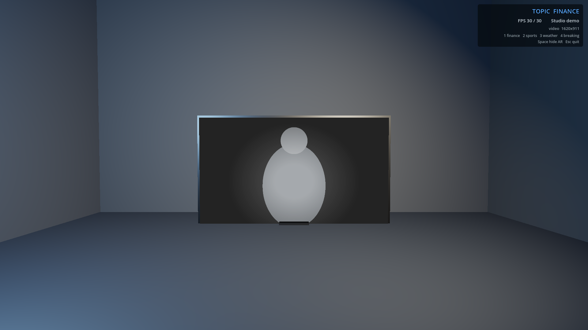

# StageForge

**Автоматическая виртуальная студия с AR-композитингом в реальном времени.**

[](https://github.com/FelixRLEPERS/stageforge/actions/workflows/ci.yml)
[](https://github.com/FelixRLEPERS/stageforge/actions/workflows/docs.yml)
[](LICENSE)
[](pyproject.toml)

StageForge превращает обычную многокамерную студию в полностью
автоматизированную виртуальную среду: камеры восстанавливают
3D-геометрию площадки, пайплайн строит чистый альфа-канал без
хромакея, а AR-контент композитится в реальном времени и уходит в эфир
по SDI Key/Fill или NDI.

## Зачем это нужно

- Не нужен зелёный фон (хромакей).
- Не нужна ручная калибровка камер перед каждым эфиром.
- AR-контент автоматически привязывается к теме комментария диктора.
- Работает с уже имеющимся эфирным оборудованием.

## Архитектура (5 слоёв)

1. Захват (SDI/NDI + генлок)
2. Реконструкция и трекинг (SfM, ToF, Free-D)
3. Сегментация и альфа (AI-ключер / на основе глубины)
4. Композитинг и AR (рендер-слой Godot)
5. Вывод (SDI Key/Fill, NDI)

Смотрите [docs/02-architecture.md](docs/02-architecture.md).

## 🎬 Живое демо студии (Godot)



Рендер-слой прогоняет всю цепочку вживую: Python-пайплайн пишет один
слот RGBA-кадра на диск (`GodotOutputSink` → `out/godot_frame.rgba`),
`godot/receiver.gd` подхватывает его как плиту ведущего, а Godot
композитит кадр в виртуальную студию 1920×1080 — пол, стены, свет,
плита с картинкой и эфирный HUD. Стабильные 30 к/с на
`gl_compatibility`.

```bash
# 1) кормим плиту (синтетический режим: ни камеры, ни GPU)
#    в конфиге укажите output.mode: "godot" — см. docs/06-compositing-ar.md
python -m stageforge.orchestrator --config configs/dev.yaml --dry-run --frames 30

# 2) рендерим (портативный Godot 4.4+, режимы запуска — в godot/README.md)
godot --path godot
```

Клавиши: `1`–`4` — смена темы (finance / sports / weather / breaking),
`Space` — скрыть или показать AR-группу, `Esc` — выход. Подробный
разбор: [`godot/README.md`](godot/README.md).

## Статус

🚧 Преп-MVP каркас. См. [docs/11-roadmap.md](docs/11-roadmap.md).

## Быстрый старт

```bash
git clone https://github.com/FelixRLEPERS/stageforge.git
cd stageforge
./scripts/bootstrap.sh      # или .\scripts\bootstrap.ps1 в Windows
make test
```

### ML-зависимости на CUDA-машине

Экстра `[ml]` тянет `torch>=2.0` с PyPI — pip резолвит это в **CPU-колесо**
и молча заменяет уже установленный CUDA-билд. На машине с GPU ставьте
torch с индекса PyTorch **первым**, затем StageForge без резолва
зависимостей:

```bash
pip install torch torchvision --index-url https://download.pytorch.org/whl/cu124
pip install -e ".[ml]" --no-deps
pip install transformers timm
```

(На CPU-only машине достаточно `pip install -e ".[ml]"`.) Для ONNX-бэкенда
добавьте `pip install -e ".[onnx-gpu]"` — или `".[onnx]"` для CPU — и один
раз экспортируйте модель: `python scripts/export_depth_onnx.py`.

## Документация

Вся документация — в каталоге [`docs/`](docs/index.md).
Английский оригинал: [`README.md`](README.md).

## Участие в разработке

См. [CONTRIBUTING.md](CONTRIBUTING.md). Участвуя в проекте, вы
соглашаетесь с [Кодексом поведения](CODE_OF_CONDUCT.md).

## Лицензия

Apache License 2.0 — см. [LICENSE](LICENSE).
